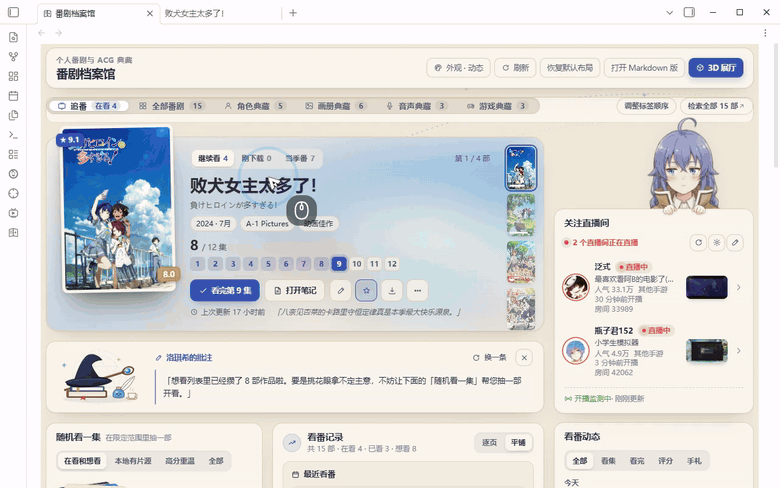
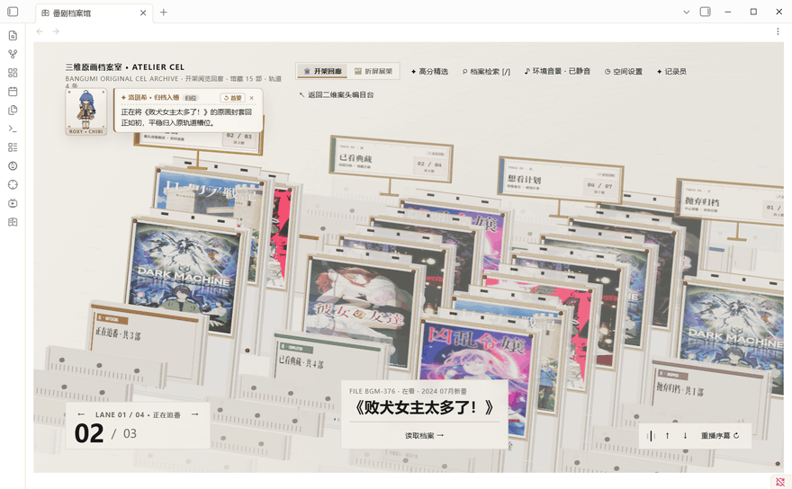
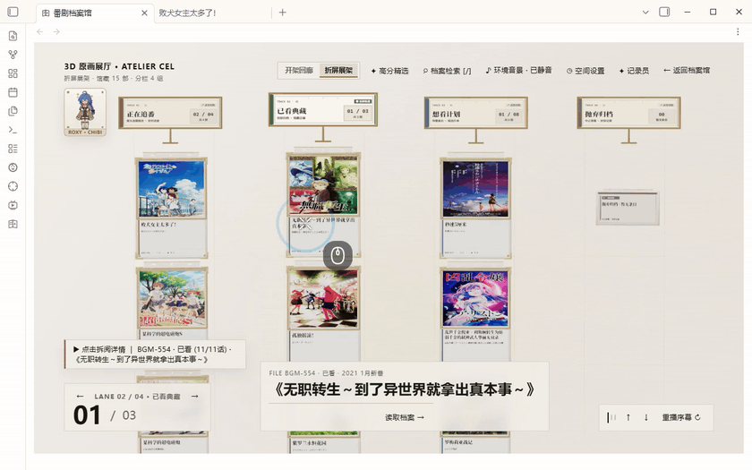
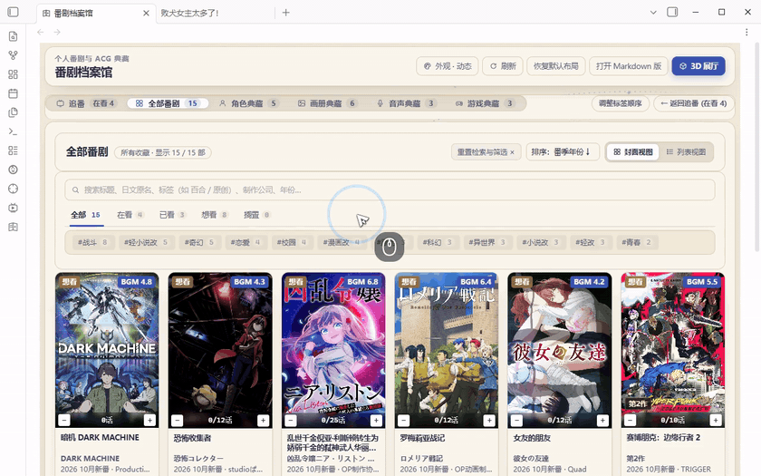

# Bangumi 追番管理器 (Bangumi Manager)

> **把你的 Obsidian 变成跨桌面与移动端的私人追番与原画典藏馆。**  
> 集 **Bangumi 追番自动编目**、**双空间档案馆（二维案头编目台 & 三维原画档案室）**、**3D 双子视图与立式分栏导视牌**、**双风格 Blender 精雕 PBR 装帧与洛琪希伴读记录员**、**角色典藏阁与跨番等身标尺**、**画册与台词音声库**、**观片手札帧级空降** 及 **漫猫单集唯一 RSS + qBittorrent 自动追番下载** 于一体的 Obsidian 全平台插件（支持 Windows / macOS / Linux / Android / iOS）。



---

## 核心功能亮点

- **双空间番剧档案馆，一秒切换阅读与策展视角**  
  内置实用的 **二维案头编目台** 与沉浸式 **三维原画档案室**。二维案头聚合正在追番、本地待看更新、自定义多季度横向滑动席位、编目总览、角色、画册、台词音声与游戏典藏；三维空间将每部收藏化作可抽起检阅、翻转拆解与抽出随附手札纸页的实体原画封套。

- **全新三维「状态与收藏轨」双子视图 + 常驻立式分栏导视牌**  
  每条状态或自定义收藏轨前缘常驻悬浮和纸黄铜 **立式分栏导视牌**，实时显示轨道名称、印记、总收录部数与当前浏览游标——即使单轨收录 200+ 部动画纵向深翻也绝不迷失，且支持鼠标或触控直接点击三维导视牌切列。顶栏支持一键切换两种陈列形态，与「✦ 高分精选」四柱聚光策展厅形成鲜明互补：
  - **🏛 开架阅览回廊**：宽敞列距与选中轨微让行分道、翻书口微倾敞口，配合横向滑轨平移跟焦运镜（Dolly Pan），多轨全局与当前焦点一目了然；
  - **🖼 画报折屏展架**：将各轨道展开为面向镜头的原画展斜靠画架陈列墙，同屏直览各轨导视牌与多排完整正面封面海报，支持列内独立翻阅与点击抽起详情。



- **双视觉扩展包按需一键下载，主程序零体积负担**  
  未下载外部资源时，插件默认启用内置 **轻量像素洛琪希** 与 **标准轻量原画夹**，开箱即用；在插件设置或馆内点击一键下载，即可免解压自动解锁 **洛琪希 7 张高清半身透明立绘包**，以及包含 **赛璐珞原画装裱夹** 与 **典藏精装 BD 礼盒**（含棉纸、亚麻布纹与拉丝黄铜 PBR 材质）的三维精装扩展包，实时热切换装帧外观。



- **说明书式「快速开始模式」+ 全平台 PC / 手机端无缝协同**  
  首次上手默认呈现循序渐进的五步开馆指南，侧边栏双入口按钮按真实外观内联展示、点击图标即可更换样式；切换至「专业模式」可使用顶栏聚光灯模糊搜索（支持拼音首字母与功能别名）统管全部进阶选项。底层全面适配 **Android / iOS 移动端** 触控手势与跨端安全只读保护，手机端同步编辑进度与评分绝不误改电脑端本地视频路径。

- **观片手札帧级空降 + 单集唯一 RSS 自动追番 + 多维典藏工作台**  
  在追番卡片内随手记分集吐槽并打下 `EP03 · 14:20` 时间码，桌面端点击即可拉起 PotPlayer / MPV / VLC / 弹弹play 精准空降到对应视频帧；内置漫猫动漫单集唯一去重 RSS 生成器与本机 qBittorrent 规则查重直投；角色典藏阁支持萌娘百科萌点聚合与 `0cm–200cm` 跨番等身身高标尺同台对比。

---

## 3 步快速安装（PC 桌面端 & Android / iOS 手机端通用）

插件最低要求 Obsidian `v1.4.0` 及以上版本，**桌面端（Windows / macOS / Linux）与移动端（Android / iOS）均可直接安装运行**。

### 方式一：通过 BRAT 安装（推荐，桌面端与手机端均支持一键更新）

1. 在 Obsidian「设置 -> 第三方插件 -> 社区插件市场」中搜索安装并启用 **BRAT**。
2. 打开 BRAT 插件设置，点击 **Add Beta plugin**，填入本仓库地址：

```text
https://github.com/Curelove/bangumi-manager
```

3. 点击 **Add Plugin** 完成后，返回「设置 -> 第三方插件」开启 **Bangumi 追番管理器** 即可。

### 方式二：通过 GitHub Releases 手动安装

1. 前往 [Releases 页面](https://github.com/Curelove/bangumi-manager/releases) 下载最新版本的 **`main.js`** 与 **`manifest.json`** 两个文件。
2. 在你的 Obsidian 仓库下新建插件文件夹 `.obsidian/plugins/bangumi-manager/`，将上述两个文件放入其中。
3. 重新加载 Obsidian 或刷新第三方插件列表，启用 **Bangumi 追番管理器**。

安装完成后的插件目录结构如下：

```text
<你的 Obsidian 仓库>/
└── .obsidian/
    └── plugins/
        └── bangumi-manager/
            ├── main.js                # 必需：插件主程序
            ├── manifest.json          # 必需：插件清单
            └── assets/                # 可选：在插件设置内点击「一键下载扩展包」后自动生成
                ├── roxy/              # 洛琪希高清透明立绘包
                └── atelier-hd-pack/   # 三维双风格精装 GLB 模型与 PBR 材质包
```

### 手机端（Android / iOS）安装与多端同步说明

- **如何在手机上安装插件**：
  - 如果你已在电脑端安装插件并开启了包含 `.obsidian/plugins/` 的多端同步（如 **Obsidian 官方 Sync**、**Syncthing / FolderSync**、**iCloud Drive** 或开启了插件同步的 **Remotely Save**），手机端打开仓库后只需在「设置 -> 第三方插件」启用插件即可直接使用，无需重复下载。
  - 如果你的多端同步未包含 `.obsidian` 配置目录，可在手机端 Obsidian 先装好 **BRAT**，按上方「方式一」输入仓库地址一键拉取安装。
- **手机端完整支持的能力**：
  - 搜索导入单部动画、按 Bangumi 用户 ID 批量同步追番列表与评分；
  - 浏览与操作 **二维案头编目台**（自适应移动端单列卡片排版、更新话数、撰写观片手札、查阅角色与画册）；
  - 触控漫游 **三维原画档案室**（单指上下滑动翻阅轨道、左右滑动或点击三维导视牌切列、双视图切换、点击封套升起详情、自适应高刷省电渲染档位）；
  - 在插件设置中直接在线一键下载洛琪希高清立绘包与三维精装模型扩展包。
- **跨端路径安全保护机制**：
  - 桌面端专属能力（本地播放器进程唤起、本地磁盘视频扫描、FFmpeg 截取与本机 qBittorrent 联动）在手机端会自动切换为**跨端只读兼容模式**，绝不会清空或覆盖笔记里原有的电脑本地视频路径。

---

## 新手 5 步开馆指南（对应插件内「快速开始模式」）

安装启用后打开「设置 -> Bangumi 追番管理器」，按照默认的 **快速开始模式** 顺序即可轻松完成开馆：



1. **一、账号与导入动画**  
   直接点击 **「导入单个动画」** 输入作品名即可搜索建档并自动下载本地高清封面；若希望把自己在 Bangumi 上的「在看 / 已看 / 想看」片单一次性导入仓库，先填入纯数字 **Bangumi 用户 ID**（个人主页网址末尾数字），再点击 **「批量导入动画」**。
2. **二、相关路径**  
   插件已预设好清晰的目录结构（默认无需改动）：
   - **动画笔记目录**：`动画笔记`（Markdown 档案馆快照位于 `动画笔记/追番广场`）
   - **角色典藏笔记目录**：`角色典藏`
   - **封面与分类附件目录**：`附件/动画封面`、`附件/角色立绘`、`附件/画册典藏`、`附件/观片手札图片`、`附件/台词音声库`
   - 日后若修改任意仓库目录路径，离开输入框后插件会自动在后台迁移已有文件并同步更新所有笔记引用，可在 **「查看路径迁移状态」** 中实时查看进度。
3. **三、侧边栏按钮**  
   左侧功能栏默认常驻显示 **「打开番剧档案馆」**（双翼档案册图标）与 **「Bangumi 追番管理器」**（复古小电视图标）两个快捷入口。在设置页直接点击对应的图标按钮，即可打开图标选择器自由更换内置图标或 Obsidian 图标库样式。
4. **四、下载扩展包**  
   点击一键下载 **「洛琪希高清立绘扩展包」** 与 **「三维精装模型与 PBR 材质扩展包」**，并可在「标准轻量原画夹 / 赛璐珞原画装裱夹 / 典藏精装 BD 礼盒」三种实体装帧风格间实时切换。
5. **五、进入番剧档案馆**  
   点击 **「立即打开番剧档案馆」** 或左侧边栏图标即可开始使用。哪怕仓库暂时还是空的，馆内也支持一键开启内存级示例样片先行体验二维与三维全部交互。

---

## 进阶能力一览（切换至「专业模式」解锁完整配置）

当你需要深度定制自动化工作流时，可在设置页顶部或底部引导卡一键切换至 **专业模式**（切换模式仅改变设置项展示，绝不改动已有配置）：

- **观片手札与本地播放器帧级空降**：自动探测本机 PotPlayer、弹弹play、MPV、VLC、MPC-HC/BE（支持填写 `.exe` 或 `.lnk` 快捷方式），点击手札上的 `▶ EP01 · 14:20` 时间码直接打开对应话数视频并精准跳转到对应秒数。
- **漫猫单集唯一 RSS 与 qBittorrent 查重联动**：聚合 `comicat.org` 字幕组发布流，自动剔除合集并用 `v2` 修正版替换 `v1`，生成单集唯一 `.xml` 订阅链接；写入前自动扫描本机 qBittorrent `download_rules.json` 与 `feeds.json` 防止重复订阅，支持一键补齐本地缺失集数。
- **角色典藏阁与跨番等身身高标尺**：自动抓取 Bangumi 角色档案与萌娘百科萌点标签，生成个人萌点与声优偏好加权排行；在 `0cm–200cm` 等身标尺架上支持立绘智能去底、去留白与拖拽基准线对齐。
- **画册典藏与台词音声库**：内置 Pixiv 在线插画检索（支持全年龄分级与 AI 作品过滤）一键落盘收藏，以及视频片段台词音声抽取归档。
- **二十年编年魔导书脊与四季排期雷达**：按纪元书脊回顾历年追番轨迹与完结共鸣率，展开春夏秋冬四季展龛，对比个人评分与 Bangumi 公共评分分差（Δ）及 Netaba 历史评分曲线。
- **看板娘角色与台词工坊**：支持将伴读记录员替换为任意自定义角色名称、自定义 8 态情绪图片路径与专属台词库。

---

## 数据安全承诺

- **零破坏性文件操作**：插件绝不自动删除你的任何动画笔记或电脑上的本地视频文件；批量导入遇到同名笔记自动安全跳过，绝不覆盖你手写的观片长评与手札。
- **跨端与离线稳健容错**：网络波动时完整保留本地封面、评分缓存与个人打分；单条异常本地路径做独立隔离兜底，绝不影响档案馆整体加载。

---

## 帮助、反馈与交流

- **提交 Bug 或功能建议**：[GitHub Issues](https://github.com/Curelove/bangumi-manager/issues)（可在插件设置底部点击 **「📋 复制排障环境信息」** 一键复制版本与运行环境模板后粘贴提交）。
- **官方 QQ 交流群**：`912120107`（可在插件设置底部的交流卡片中直接点击复制群号或使用手机 QQ 扫描矢量二维码加群交流）。
- **致谢**：早期动画库目录设计思路曾参考 UP 主「一般の智人」的教程《Obsidian + Bangumi 动画库搭建与实时追番教程》及 [@北漠海](https://github.com/beimohai/Bangumi-to-obsidian-lite) 的开源脚本项目，谨致谢忱。

---

## 本地开发与构建

环境要求：Node.js 18 及以上版本。

```bash
npm install
npm run build
```

注意：所有源码模块均位于 `src/` 目录下，请勿直接手改根目录构建产物 `main.js`，修改 `src/` 后运行 `node build.js` 即可重新生成单文件产物。

本项目原创源码采用 [MIT License](LICENSE) 开源。Bangumi、萌娘百科、Netaba、Comicat、Pixiv 等外部站点及其对应数据与图标权利归各自所有者所有。
