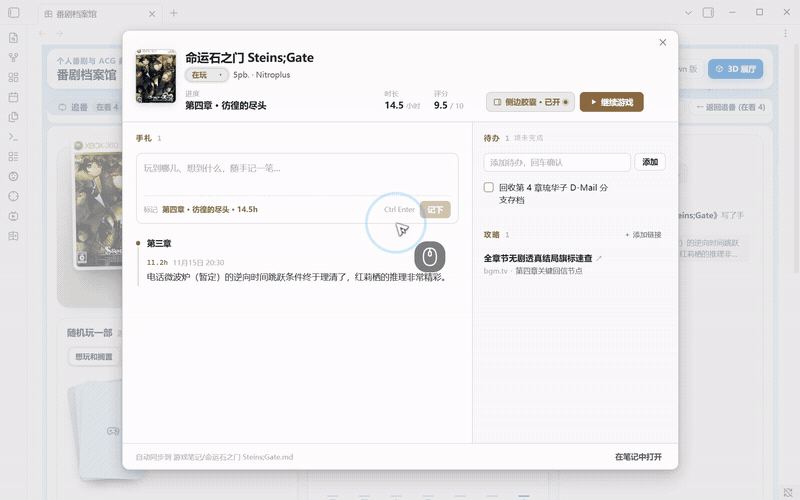

# Bangumi 追番管理器 (Bangumi Manager)

> **把你的 Obsidian 变成跨桌面与移动端的私人追番与 ACG 原画典藏馆。**  
> 集 **Bangumi 追番自动编目**、**六大典藏展馆（追番 / 全部番剧 / 角色 / 画册 / 音声 / 游戏）**、**四站评分对比（Bangumi / AniList / MyAnimeList / Filmarks）**、**2.5D 画廊展墙与精装翻书画集**、**3D 原画展厅双子视图与 Blender 精雕 PBR 装帧**、**洛琪希动态伴读视线交互**、**角色跨番等身标尺**、**观片手札帧级空降** 及 **漫猫单集唯一 RSS + qBittorrent 自动追番下载** 于一体的 Obsidian 全平台插件（支持 Windows / macOS / Linux / Android / iOS）。


---

## 核心功能亮点

- **六大典藏展馆与双空间架构，一秒切换日常追番与沉浸策展**  
  内置直观顺手的「**番剧档案馆**」主工作台与全三维「**3D 原画展厅**」，顶部七大模块（六大典藏 + 评分对比）支持按个人习惯自由拖拽排序：
  - **追番（焦点追番台）**：聚合「继续看 / 刚下载 / 当季番」三轨焦点卡片、洛琪希实时视线跟随立绘与手记便签、暗房级「看番统计」偏好洞察抽屉、随机抽一集动画，以及可选的关注 UP 主直播状态看板；
  - **全部番剧**：支持「封面视图」与「列表视图」无缝切换，内置自定义「精选片单」与多条件「智能筛选」；
  - **评分对比**：一键同步 Bangumi（华语）、AniList（英文）、MyAnimeList（欧美）、Filmarks（日本）四站评分，用按各站原生分制对齐的「换算尺」直观看出四站是否一致（悬停或拖动即可换算），并提供综合排行、意见分歧、东西温差散点图（可扣除各站给分习惯）、我的反差四种视角、四路权重推子与个人口味契合度；全馆封面评分角标可切换优先显示任一站或跨站综合分；
  - **角色典藏**：多源融合检索 Bangumi 角色库（API + 网页多页翻扫 + 热度重排 + 萌娘百科异译名互通与无代理直连兜底），支持快速连点多位角色建立「待收录队列」一键批量入库，自动汇聚角色履历与萌点特征排行，配备 `0cm–200cm` 跨番等身身高标尺；
  - **画册典藏**：提供「展厅」2.5D 画框展墙、「画集」亚麻精装仿真翻书与「总览」瀑布流三种赏析视角，支持本地拖入与 Pixiv 在线检索一键收藏；
  - **音声典藏**：绑定本地番剧目录后可按内封软字幕精准切片原片语音，未配置本地视频或处于移动端时零等待抽取经典动漫名言卡片；
  - **游戏典藏、离线时长后台守卫与全屏侧边手札胶囊**：支持 Bangumi / VNDB / Steam / 月幕多源检索建档、多游戏并发时长追踪与可删除/补录明细统计；Windows 桌面端支持在设置页或游戏典藏顶栏一键开启零显存、仅占约 3–8 MB 内存的极轻原生后台守卫（默认关闭、可配随开机自启与一键卸载清理），关闭 Obsidian 期间照常记录游戏启停（自动排除睡眠休眠与 15 秒启动器交接防抖），玩到一半打开 Obsidian 即刻实时同步显示「游玩中」时长；桌面端启动或直接从桌面 / Steam / WeGame 运行已收录游戏时，可选自动挂起支持 `0%` 全透明隐形、双屏跟随与跨屏拖拽磁吸的侧边手札胶囊（与时长记录相互独立）。



- **三维「状态与收藏轨」双子视图 + 常驻立式分栏导视牌**  
  每条状态或自定义收藏轨前缘常驻悬浮和纸黄铜 **立式分栏导视牌**，实时显示轨道名称、印记、总收录部数与当前浏览游标——即使单轨收录 200+ 部动画纵向深翻也绝不迷失，且支持鼠标或触控直接点击三维导视牌切列。顶栏支持一键切换两种陈列形态，与「✦ 高分精选」四柱聚光策展厅形成鲜明互补：
  - **开架阅览回廊**：宽敞列距与选中轨微让行分道、翻书口微倾敞口，配合横向滑轨平移跟焦运镜（Dolly Pan），多轨全局与当前焦点一目了然；
  - **画报折屏展架**：将各轨道展开为面向镜头的原画展斜靠画架陈列墙，同屏直览各轨导视牌与多排完整正面封面海报，支持列内独立翻阅与点击抽起详情。


- **6 套主题外观 + 晴空画集光学转场 + 双视觉扩展包按需下载，主程序零体积负担**  
  顶栏「外观 · 动态」内置跟随系统、暖色纸本、封面柔光、夜间影院、洛琪希手记与 **晴空画集**（含「晴空棱镜 / 白羽柔纱 / 澄水涟漪」三款清透光学转场）6 套主题配色。未下载外部资源时默认启用校准版 **Q 版洛琪希立绘** 与 **标准轻量原画夹**，开箱即用；在插件设置或馆内点击一键下载（多镜像自动择优加速），即可免解压自动解锁 **洛琪希高清半身透明立绘包**，以及包含「**赛璐珞原画装裱夹**」与「**典藏精装 BD 礼盒**」（含棉纸、亚麻布纹与拉丝黄铜 PBR 材质）的三维精装扩展包，实时热切换实体装帧。

- **说明书式「快速开始模式」+ 全平台桌面端 / 手机端深度适配**  
  首次上手默认呈现零干扰的五步开馆指南（哪怕仓库尚无任何笔记，也可一键开启内存级示例样片完整体验二维与三维交互）；切换至「专业模式」可使用顶栏聚光灯模糊搜索（支持拼音首字母与功能别名）统管全部进阶选项，并支持顶栏一键切换「**简略说明**」（手机端默认开启、电脑端默认关闭，各自独立记忆，单项旁保留 `i` 按需展开）且操作任意选项严锁滚动位置不跳顶。底层全面适配 **Android / iOS 移动端**：3D 展厅与桌面端侧边手札胶囊按需懒加载大幅提速冷启动、窄屏竖屏零横向溢出、评分与话数自动转为底部触控抽屉（Bottom Sheet）、画册灯箱与 3D 展厅支持双指捏合缩放、萌娘百科自动切换移动端粘贴解析通道，且手机端编辑进度绝不误改电脑本地视频路径。

- **观片手札帧级空降 + 多页聚合找番与可视化自动追更**  
  在追番卡片内随手记分集吐槽并打下 `EP03 · 14:20` 时间码，桌面端自动探测 Windows / macOS / Linux 本机播放器（PotPlayer / IINA / MPV / VLC / 弹弹play / MPC-HC），点击即可精准空降到对应视频帧；内置漫猫多页聚合检索（联动蜜柑计划条目核验、动漫花园存档与 Bangumi 别名，严格过滤无关串番与衍生短篇），支持按字幕组锁定追更、馆内直显「追更中」状态并随时一键暂停或集中管理。
- **跨盘符「本地视频关联」工作台（原地绑定 · 暂存整理 · 智能扫描 · 互动演示）**  
  电脑里早就下载好、分散在不同磁盘与目录结构下的老番与特典无需移动或改名（不破坏原有播放器与下载器做种索引），通过双栏「本地视频关联」工作台即可原地绑定到对应动画笔记与单集槽位；内置电脑目录浏览器与持久化暂存区，支持直接拖放或从外部资源管理器拖入动画卡片 / 第 N 集格子（同时完整保留系统原生文件与文件夹选择窗口）、多目录一键「智能扫描匹配」、顶部「▶ 功能演示」实时互动动画教学（自适应 6 套外观与明暗模式，默认静音按需开声），以及可点击的红色「有 N 处路径待确认」徽章直达右侧修复面板集中处理失效或换盘符路径。
- **自定义新建与资料编辑（不依赖 Bangumi 收录）**  
  对于 Bangumi 未收录的 OVA、独立动画、小众作品或同人映像，可从左侧边栏「Bangumi 追番管理器」菜单、单个动画导入空结果兜底或命令面板一键新建自定义动画：完整自定义片名、封面（上传 / 拖放 / Ctrl+V 粘贴 / 网络图下载）、集数与进度、个人评分、开播日期与「不分季」、载体类型、制作团队、标签、自定义参考评分与外部链接及本地目录；后续可随时在卡片或舞台中编辑资料（100% 保留手记正文）或补绑 Bangumi 条目，并与评分同步、Netaba 趋势、四站对比、本地视频关联全模块无冲突协作。

---

## 3 步快速安装（PC 桌面端 & Android / iOS 手机端通用）

插件最低要求 Obsidian `v1.4.0` 及以上版本，**桌面端（Windows / macOS / Linux）与移动端（Android / iOS）均可直接安装运行**。

### 方式一：通过 BRAT 安装（推荐，桌面端与手机端均支持一键更新）

1. 在 Obsidian「设置 -> 第三方插件 -> 社区插件市场」中搜索安装并启用 **BRAT**。
2. 打开 BRAT 插件设置，点击 **Add Beta plugin**，填入本仓库地址：

```text
https://github.com/Curelove/bangumi-manager
```

3. 点击 **Add Plugin** 完成后，返回「设置 -> 第三方插件」开启 **Bangumi 追番管理器** 即可。

### 方式二：通过 GitHub Releases 手动安装

1. 前往 [Releases 页面](https://github.com/Curelove/bangumi-manager/releases) 下载最新版本的 **`main.js`** 与 **`manifest.json`** 两个文件。
2. 在你的 Obsidian 仓库下新建插件文件夹 `.obsidian/plugins/bangumi-manager/`，将上述两个文件放入其中。
3. 重新加载 Obsidian 或刷新第三方插件列表，启用 **Bangumi 追番管理器**。

安装完成后的插件目录结构如下：

```text
<你的 Obsidian 仓库>/
└── .obsidian/
    └── plugins/
        └── bangumi-manager/
            ├── main.js                # 必需：插件主程序
            ├── manifest.json          # 必需：插件清单
            └── assets/                # 可选：在插件设置内点击「一键下载扩展包」后自动生成
                ├── roxy/              # 洛琪希高清透明立绘包
                └── atelier-hd-pack/   # 三维双风格精装 GLB 模型与 PBR 材质包
```

### 手机端（Android / iOS）安装与多端同步说明

- **如何在手机上安装插件**：
  - 如果你已在电脑端安装插件并开启了包含 `.obsidian/plugins/` 的多端同步（如 **Obsidian 官方 Sync**、**Syncthing / FolderSync**、**iCloud Drive** 或开启了插件同步的 **Remotely Save**），手机端打开仓库后只需在「设置 -> 第三方插件」启用插件即可直接使用，无需重复下载。
  - 如果你的多端同步未包含 `.obsidian` 配置目录，可在手机端 Obsidian 先装好 **BRAT**，按上方「方式一」输入仓库地址一键拉取安装。
- **手机端完整支持的能力**：
  - 搜索导入单部动画、按 Bangumi 用户 ID 批量同步追番列表与评分、搜索建档游戏收藏（选中候选后多余结果自动折叠收纳并引导至保存区）；
  - 浏览与操作 **番剧档案馆** 七大模块（四站评分对比、自适应手机竖屏排版、底部弹出评分与话数抽屉、撰写观片与游戏手札、画册灯箱单指滑页与双指缩放、音声名言抽取、右下角下拉洛琪希返回顶部）；
  - 移动端 B 站开播监控支持优先唤起 B 站客户端 / 平板 B 站 HD / 每次询问底部抽屉 / 网页版，首次授权期间防误弹浏览器冲突；游戏典藏支持独立配置手机端 URL Scheme / iOS 快捷指令一键唤起并同步计时；
  - 触控漫游 **3D 原画展厅**（单指滑动翻阅轨道、双指捏合推拉镜头、点击三维导视牌切列、双视图切换、自适应省电渲染档位）；
  - 在插件设置中直接在线一键下载洛琪希高清立绘包与三维精装模型扩展包（自定义看板娘图片亦自动导入仓库相对路径，多端同步直接可见）。
- **跨端路径安全保护机制**：
  - 桌面端专属能力（本地播放器进程唤起、本地磁盘视频扫描、FFmpeg 原片语音切片与本机 qBittorrent 联动）在手机端会自动切换为**跨端只读兼容模式**，绝不会清空或覆盖笔记里原有的电脑本地视频路径。

---

## 安装后 5 步开馆指南（对应插件内「快速开始模式」）

安装启用后打开「设置 -> Bangumi 追番管理器」，按照默认的 **快速开始模式** 顺序即可轻松完成开馆：


1. **一、账号与导入动画**  
   直接点击「**导入单个动画**」输入作品名即可搜索建档并自动下载本地高清封面；若希望把自己在 Bangumi 上的「在看 / 已看 / 想看」片单一次性导入仓库，先填入纯数字 **Bangumi 用户 ID**（个人主页网址末尾数字），再点击「**批量导入动画**」。
2. **二、相关路径**  
   插件已预设好清晰的仓库内相对目录结构（默认无需改动，本地动画视频根目录未整理时可直接留空）：
   - **动画笔记目录**：`动画笔记`（Markdown 档案馆快照位于 `动画笔记/追番广场`）
   - **角色典藏笔记目录**：`角色典藏`
   - **封面与分类附件目录**：`附件/动画封面`、`附件/角色立绘`、`附件/画册典藏`、`附件/观片手札图片`、`附件/游戏封面`、`附件/音声典藏`（已有 `附件/台词音声库` 自动兼容）
   - 日后若修改任意仓库目录路径，离开输入框后插件会自动在后台迁移已有文件并同步更新所有笔记引用；若更换电脑上的「**本地动画根目录**」，插件还会贴心提示一键批量替换旧盘符前缀或解绑旧目录关联。
3. **三、侧边栏按钮**  
   左侧功能栏默认常驻显示「**打开番剧档案馆**」（双翼档案册图标）与「**Bangumi 追番管理器**」（复古小电视图标）两个快捷入口。在设置页直接点击对应的图标按钮，即可打开图标选择器自由更换内置图标或 Obsidian 图标库样式。
4. **四、下载扩展包**  
   点击一键下载「**洛琪希高清立绘扩展包**」与「**三维精装模型与 PBR 材质扩展包**」，并可在「标准轻量原画夹 / 赛璐珞原画装裱夹 / 典藏精装 BD 礼盒」三种实体装帧风格间实时切换。
5. **五、进入番剧档案馆**  
   点击「**立即打开番剧档案馆**」或左侧边栏图标即可开始使用。哪怕仓库暂时还是空的，馆内也支持一键开启内存级示例样片先行体验二维与三维全部交互。

---

## 进阶能力一览（切换至「专业模式」解锁完整配置）

当你需要深度定制自动化工作流时，可在设置页顶部或底部引导卡一键切换至 **专业模式**（切换模式仅改变设置项展示，绝不改动已有配置）：

- **观片手札与跨平台本地视频多层级识别、帧级空降**：原「本地动画根目录」现已明确为「新下载默认保存目录」（专用于新番下载保存），各盘符下已有视频统一交由「本地视频关联」跨盘原地绑定；原生支持直铺单集、**季度合集与多层 BDRip 子目录**（如 `01-12Fin`、`[SubGroup][Title][BDRIP]` 含 `SPs / Scans / Subtitles` 结构）与 **每集独立子文件夹**，精准归类 `SP / NCOP / NCED / PV / Onair OP / 小剧场 / 角色歌 / 演唱会 / 剧场版 / .5 总集篇 / BDMV` 并在检测到同集多版本或跨季混放时给出温和核对提示（支持自选默认播放版本或一键平铺提取）；自动探测本机多盘符及跨平台 PotPlayer、弹弹play、IINA、MPV、VLC、MPC-HC/BE，点击手札上的 `▶ EP01 · 14:20` 时间码直接打开对应话数视频并精准跳转到对应秒数。
- **多页聚合找番、可视化自动追更与 qBittorrent 联动**：突破漫猫单页 RSS 50 条截断，自动分页汇总全部字幕组与分辨率规格并融合蜜柑条目核验与异译名资源，严格连续片名匹配防跨番串流；内置「自动追更订阅管理」面板集中查看、暂停/恢复或取消任意番剧的自动追更，并在「追番」与「全部番剧」卡片上直接展示「追更中」状态；支持右键/底栏直达下载、窗口切回自动同步本地剧集与缺失集数。
- **角色典藏与跨番等身身高标尺**：自动抓取 Bangumi 角色档案与萌娘百科萌点标签，生成个人萌点与声优偏好加权排行；在 `0cm–200cm` 等身标尺架上支持立绘智能去底、去留白、双指缩放与拖拽基准线对齐。
- **画册典藏、音声典藏与多编码字幕自适应**：内置 Pixiv 在线插画检索（支持全年龄分级与 AI 作品过滤）一键落盘收藏；桌面端自动扫描 WinGet / Scoop / Choco / Homebrew 定位 FFmpeg，兼容子目录剧集、`Subtitles / Subs / 字幕` 外挂字幕子文件夹、网盘 `.ass.txt / .srt.txt` 字幕及 `UTF-8 / UTF-16LE / GB18030` 编码自动识别与内封软字幕原片语音切片。
- **游戏典藏、全屏侧边手札胶囊与全类型快捷方式启动**：一站式检索收录 PC / 主机 / 视觉小说作品，桌面端原生支持 `.exe`、Steam `.url` 桌面快捷方式、`.lnk`、`.bat/.cmd` 启动脚本（自动接管启动器壳进程秒退与 Steam 重启）及 macOS `.app` 应用包；游戏运行时自动在当前游戏显示器边缘挂起跟随 6 套馆藏主题的侧边手札胶囊（支持打字时临时自动收起系统任务栏、退出即还原）。
- **看番统计洞察与评分趋势对比**：随时呼出暗房级统计抽屉审视常看动画公司、开播年代分布与题材偏好，对比个人评分与 Bangumi 大众评分差值（Δ）及 Netaba 历史评分曲线。
- **看板娘角色与台词工坊**：支持将伴读记录员替换为任意自定义角色名称、自定义 8 态情绪图片（自动拷入仓库支持多端同步）与专属台词库。

---

## 帮助、反馈与交流

- **提交 Bug 或功能建议**：[GitHub Issues](https://github.com/Curelove/bangumi-manager/issues)（可在插件设置底部点击「**📋 复制排障环境信息**」一键复制版本与运行环境模板后粘贴提交）。
- **官方 QQ 交流群**：`912120107`。
- **致谢**：早期动画库目录设计思路曾参考 UP 主「一般の智人」的教程《Obsidian + Bangumi 动画库搭建与实时追番教程》及 [@北漠海](https://github.com/beimohai/Bangumi-to-obsidian-lite) 的开源脚本项目，谨致谢忱。

---

## 本地开发与构建

环境要求：Node.js 18 及以上版本。

```bash
npm install
npm run build
```

注意：所有源码模块均位于 `src/` 目录下，请勿直接手改根目录构建产物 `main.js`，修改 `src/` 后运行 `node build.js` 即可重新生成单文件产物。

本项目原创源码采用 [MIT License](LICENSE) 开源。Bangumi、萌娘百科、Netaba、Comicat、Pixiv、VNDB、Steam 等外部站点及其对应数据与图标权利归各自所有者所有。
